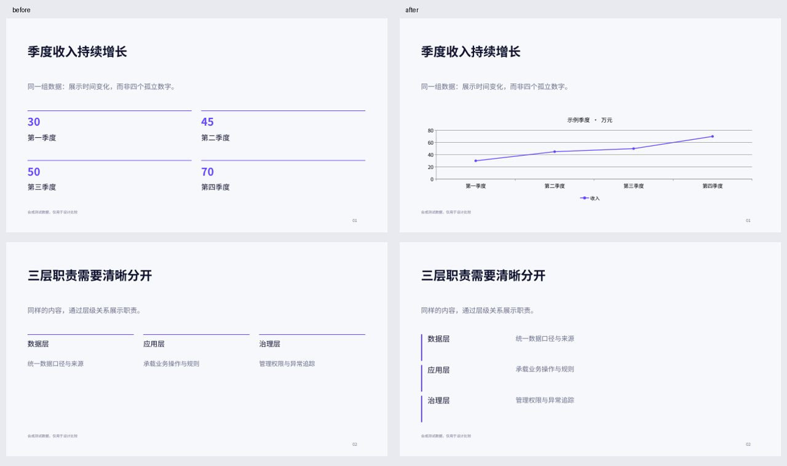

# Leego Design PPT 2.2：诊断、设计决策与持续更新

2026-10-25。基于现有 2.1 本地版本与用户提供的两段讨论升级。采用“先诊断、再分类、再决策、再验证”的方法，保留现有输出链路。

## 现有能力诊断

| 对象 | 观察到的能力与问题 | 本轮处理 |
|---|---|---|
| SKILL.md | 已有叙事、品牌、排版、按需交付和逐页检查；缺少可执行的设计选择 | 增加场景、风格族、页面意图、证据形态、容量与禁用条件的选择流程 |
| layout-patterns / scene | 20 个页面名称，但多个名称共用通用分栏；不能等同 20 个独立设计引擎 | 分类记录实现层级，官网公开区分“风格指导、基础版式、具体主题” |
| theme-presets | 两个实际配色主题 | 保留；建立八个风格族指导，不虚称八套完整渲染主题 |
| PPTX | 原生文本、形状、图片、表格、柱形和折线图 | 保留；分布、构成等未实现图表返回需专项实现 |
| H5 | 离线资源、16:9、移动阅读、翻页、触控、概览与讲稿 | 保留，不引入新框架或破坏原有交互 |
| PDF | 从 PPTX 导出，支持字体目录 | 保留；继续区分生成成功与视觉验收 |
| check-update | 原来只检查远端资源，未缓存、未选择版本，也未接入任务入口 | 变为使用时拉取、完整性验证、兼容性判断、缓存与离线回退 |

## 采纳与调整

采纳：设计知识六层分类；热度与专业质量分别评估；页面需要适用/禁用条件；依据内容选择；同题比较后再推广经验。

调整：不批量抓图，不把未核实的小红书热度写成排行；不将图片代理链接视为原始出处；不建立大量空目录；不把 1920px 画布参数直接当成 PPT 点数。本轮保持 1280×720 几何与 px/pt 换算。

暂未完成：30–50 个外部优质案例、30 种独立页面模式、20 种可视化组件、10 套完整成品演示。这些是候选建设目标。本轮外部已审案例为 **0**，没有伪造案例数量或评分。

## 已实现的架构

- [设计决策规则](skill/leego-design-ppt/references/design-decision.md)：六阶段决策、选择理由、缺口与拆页条件。
- [设计知识库](skill/leego-design-ppt/data/design-library.json)：8 个原创风格族、6 个场景、20 类现有基础页面任务。
- [选择器](skill/leego-design-ppt/scripts/plan-design.mjs)：读取明确的 brief，输出设计计划、理由、状态与约束。不是完整自然语言生成器或自动审美评分器。
- [参考案例筛选规范](skill/leego-design-ppt/references/reference-learning.md)：出处、时间、平台热度、专业质量、版权、适用条件、反例、审核状态。
- [同题评测规范](skill/leego-design-ppt/references/design-evaluation.md)：事实、可读性、图表、品牌与输出检查；失败不进入正式规则。
- [更新通道](skill/leego-design-ppt/references/live-updates.md)：每次新任务检查已发布的规则，当前任务固定版本；脚本与依赖用安装包升级。

## 同题验证

基准输入使用同一组季度收入（30、45、50、70，合成数据）和同一组系统职责。左侧采用原有通用分栏，右侧采用选择器返回的折线图与架构分层。字体、画布、主题保持相同。它验证了表达选择的实际变化，不代表对新旧版本所有场景的全面审美排名。

[可编辑示例](public/examples/design-decision-example.pptx) · [生成输入与计划](examples/decision/comparison-plan.json)

## 验证记录

- 10 个设计选择场景 + 1 项非法输入检查通过。
- 8 项更新通道测试通过：正确缓存、网络失败回退、不降级、坏哈希拒绝、客户端兼容、离线/固定版本、损坏缓存与 URL/体积边界。
- 4 项可移植生成回归通过，PPTX 原生对象与 H5 离线资源仍可用。
- 同题导出共 4 页 PDF 已渲染检查：文字可读、趋势和分层表达清晰，未观察到裁切或乱码。
- 官网三个场景切换、中文/英文切换、320px 无整页横向溢出已检查；修复了窄屏中文标题的孤行问题。
- Skill 格式检查通过。生产发布结果另以实际发布回执为准。

## 向所有使用者分发的边界

这里的“持续更新”是 **审核发布后，在下一次使用时获取新规则**。它不是远程控制每个安装者的电脑。

1. 2.0/2.1 用户需要先升级一次至 2.2+。
2. 网络及 Node 允许时，宿主按 SKILL.md 在新任务入口运行检查，验证规则后采用；离线或受限环境继续使用已有快照。
3. 规则兼容时无需重装。新脚本、依赖、目录结构或协议需要升级安装包。
4. 用户可以离线或固定本地版本。已经交付的演示不自动改变。
5. 此线程里的原始对话、客户素材和业务数据不会直接进入公开规则；只发布经过提炼和验证的通用方法。

## 后续建设任务

| 顺序 | 任务 | 准入条件 |
|---|---|---|
| 已完成 | 本轮诊断、规则分类、设计选择器、更新通道及官网能力表达 | 通过相关功能测试与输出检查 |
| 下一批研究 | 从小红书、Behance 等建立小规模候选集 | 有可访问的原始出处、观察时间与授权边界；热度未知保留空值 |
| 逐条提炼 | 将案例转为带适用条件、反例的规则 | 来源核实、同题验证通过、审核记录完整 |
| 扩展渲染 | 根据真实缺口实现新模式与图表 | 独立实现、可编辑性、H5/PPTX/PDF 验收；不能只增加名称 |
| 扩充基准 | 从当前选择测试扩展至完整成品集 | 同内容、同素材、同字体，并保存实际人工评审 |
